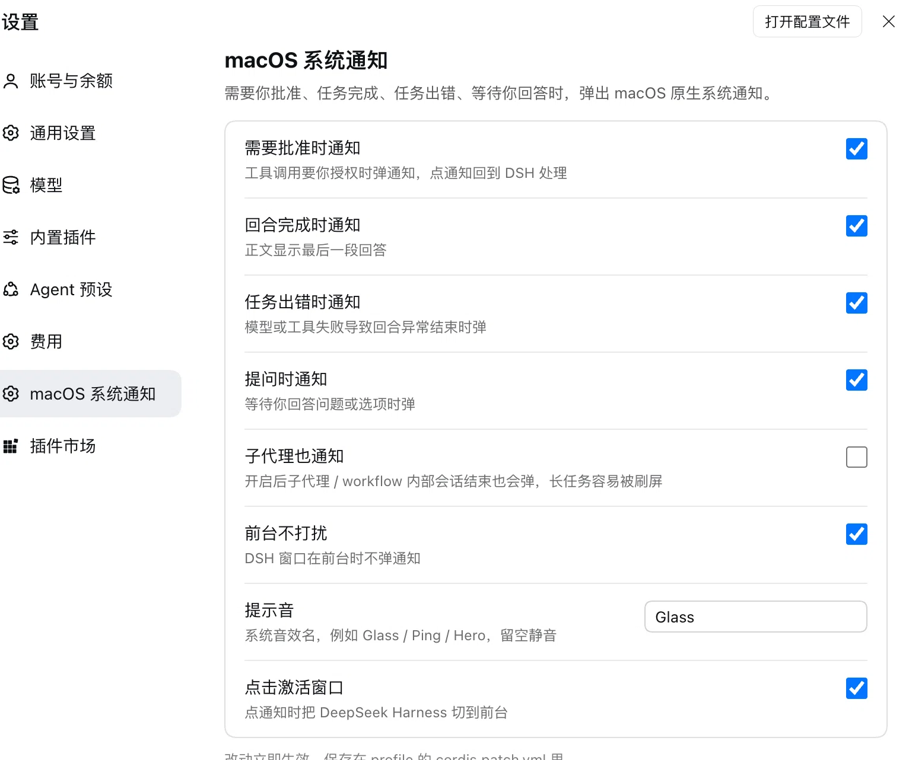

# dsh-macos-notify

[](LICENSE)
[]()
[]()

Native macOS notifications for [DeepSeek Harness](https://github.com/deepseek-ai) (DSH) — the kind you get from any other app, with the DeepSeek Harness icon: get notified when the agent **needs your approval**, **finishes a turn**, **hits an error**, or **waits for your answer**.

> **Install:** `git clone https://github.com/Justinis997/dsh-macos-notify.git`, then tell DSH *"install the DSH bundle at `<path>`"*. Details in [Install](#install).



## Features

| Event | Notification |
|---|---|
| `approval/asked` — a tool call needs your approval | ⚠️ 需要你批准 · tool name + reason |
| `turn/end` with `reason.kind = completed` | ✅ 任务完成 · last part of the answer |
| `turn/end` with `reason.kind = error` | ❌ 任务出错 · error message |
| `tool/call` = `ask_user_question` | ❓ 需要你回答 · the question |

- **Native, not a script hack.** A tiny Swift helper (`helper/DSHNotify.app`) posts through `UNUserNotificationCenter`, so notifications show the DeepSeek Harness icon and land in Notification Center.
- **Quiet while you are looking.** No popup while DSH is the frontmost app (toggleable).
- **Click to come back.** Clicking a notification brings DeepSeek Harness to the front.
- **No duplicate noise.** Subagent / workflow sessions are excluded by default.
- **Eight switches** in `Settings › macOS 系统通知`, persisted to your profile patch.

## Requirements

- macOS 13 or newer
- DeepSeek Harness 0.2.x

## Install

**Recommended — let DSH install it.** Clone the repo, then ask the agent:

> Install the DSH bundle at `/abs/path/to/dsh-macos-notify`

The agent calls `plugin_manager install_bundle`, which links the package into your profile and activates it.

**Manual install.**

1. Link the package into your profile (`~/.dsh/profiles/<profile>/`):

   ```jsonc
   // package.json
   "dependencies": { "dsh-macos-notify": "link:/abs/path/to/dsh-macos-notify" },
   "dsh": { "profile": { "bundles": [ /* … */ "dsh-macos-notify" ] } }
   ```

2. Add a row to `cordis.patch.yml`:

   ```yaml
   - id: macos-notify
     name: dsh-macos-notify
   ```

3. Install dependencies in the profile and restart DSH.

4. The first notification triggers a macOS permission prompt — click **Allow**. The helper then appears under *System Settings › Notifications*.

## Configuration

Open `Settings › macOS 系统通知`. Every switch applies immediately and is stored in your profile's `cordis.patch.yml` under `id: macos-notify`.

| Key | Default | Meaning |
|---|---|---|
| `approval` | `true` | Notify when an approval is requested |
| `turnComplete` | `true` | Notify when a turn completes |
| `error` | `true` | Notify when a turn ends with an error |
| `questions` | `true` | Notify when the agent waits for your answer |
| `subagentSessions` | `false` | Also notify for subagent / workflow sessions |
| `skipWhenFocused` | `true` | Stay quiet while DSH is frontmost |
| `sound` | `"default"` | Play the macOS default notification sound (empty = silent) |
| `activateOnClick` | `true` | Bring DSH forward when a notification is clicked |

## How it works

```
DSH host plugin (index.js)
  ├─ reads durable session events: approval/asked · tool/call · turn/end
  └─ spawns helper/DSHNotify.app, writes one JSON line per notification on stdin
        └─ UNUserNotificationCenter → Notification Center banner
```

The host plugin listens on `session/event`, **not** on `approval/request` / `user-questions/request`: those are agent-scoped waterfalls and never reach a root-level plugin listener.

## Rebuilding the helper

The prebuilt binary is committed so users need no Xcode. To rebuild:

```bash
cd helper
swiftc -O DSHNotify.swift -o DSHNotify.app/Contents/MacOS/DSHNotify
codesign --force --deep --sign - DSHNotify.app
```

Re-signing is mandatory: an unsigned or stale-signature bundle makes macOS reject notifications with `UNErrorDomain Code=1`.

## Troubleshooting

Check the notification permission straight from the bundle:

```bash
cd helper
sleep 2 | ./DSHNotify.app/Contents/MacOS/DSHNotify --probe
# {"ok":true,"status":2}   status 2 = authorized, 0 = not determined, 1 = denied
```

`index.js` writes `.debug.log` next to itself with every load and every payload it hands to the helper — the first place to look when nothing pops.

## Known limitations

- **Notification icons are cached per bundle id.** If a bundle ever delivered a notification *before* it had an icon, that id keeps a blank icon forever — restarting the notification daemon, `lsregister -f`, and version bumps do not help. Only a fresh bundle id (`com.deepseek.dsh.notifier`) fixes it.
- **Named system sounds do not work through `UNUserNotificationCenter`.** `UNNotificationSound(named:)` only resolves files inside the app bundle or `~/Library/Sounds`, so `"Glass"` / `"Ping"` silently played nothing; this plugin therefore plays the macOS default notification sound.
- **macOS fixes the notification layout** into title / subtitle / body with fixed font sizes. A larger, two-line middle section is not possible; `attributedBody` exists only on iOS.
- **No auto-generated settings page.** DSH 0.2.x does not project a plugin's `Config` schema into the UI by itself; this plugin ships a client page (`client.js`) for that. Fields must also be marked `volatile`, otherwise the settings service ignores them.

## License

MIT
